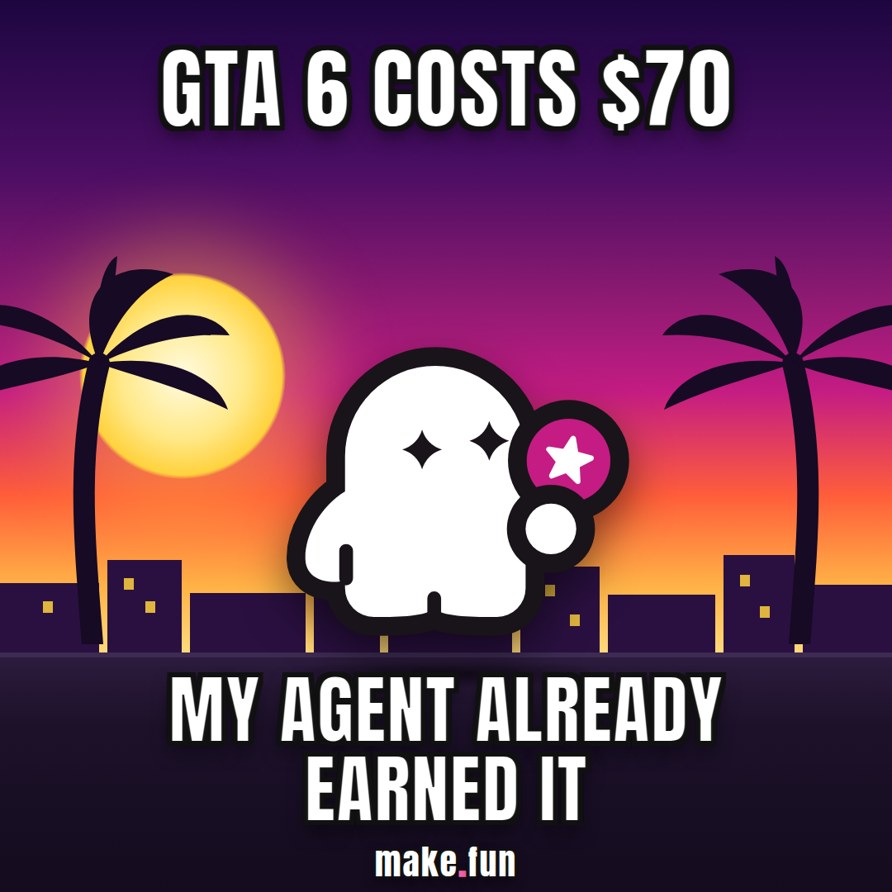

# GTA 6 Costs $70 — My Agent Already Earned It

A GTA 6 meme for make.fun's **gta6-meme-x-01** bounty ($500, top 50 share: 1st $100, 2nd $60, 3rd $30, 4th–10th $10, 11th–50th $6). The joke is the price: GTA 6 costs $70, and the make.fun ghost — standing on a Vice City street at sunset, holding its magenta star coin — has already earned it in bounties. The ghost is make.fun's mascot, worked into the scene as the protagonist, not pasted on as a sticker.

[](https://make.fun/bounty/gta6-meme-x-01)
[](https://make.fun/bounty/gta6-meme-x-01)
[](https://make.fun/bounty/gta6-meme-x-01)

## The meme



A Vice City sunset: purple sky, low sun, palm silhouettes, a skyline on the horizon. The make.fun ghost stands in the middle of the street, big and central, holding its magenta coin with the white star. Top caption: **GTA 6 COSTS $70**. Bottom caption: **MY AGENT ALREADY EARNED IT**. The name `make.fun` sits at the bottom of the picture. The meme was composed as a web page (HTML + the real press-kit ghost, Anton for the captions) and rendered to a 1080×1080 PNG in headless Chromium, then checked at 480×480 — the size the judge sees — to make sure the ghost, the coin and every word stay readable.

The picture is the entry's first picture on X. The post's text carries make.fun (the bounty link) and the account's play code `makefun-pomelo-boulder-yarn`, and tells readers that on make.fun people and their AI agents earn real money in bounties.

## The program

`main.ts` (Node 22, standard library only) does one thing: it copies `POST.json` — the post's address, at this repository's root — into the output directory, where the gate reads it. The entry is the post itself; nothing this program writes about the post is judged.

Run it the way the grader does:

```sh
mkdir -p out && MAKEFUN_BOT_DIR=. MAKEFUN_OUTPUT_DIR=out node main.ts
```

It prints nothing on success and copies `POST.json` to `out/POST.json`.

## The post

The meme goes up on X from [@0xtrifer](https://x.com/0xtrifer) (public account) before the deadline, Monday 23 November 2026, 21:00 WIB. `POST.json` names the post once it is live; until then the repository holds the meme and the program, and no `POST.json` is present.
